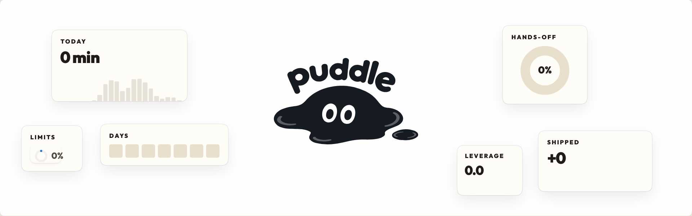
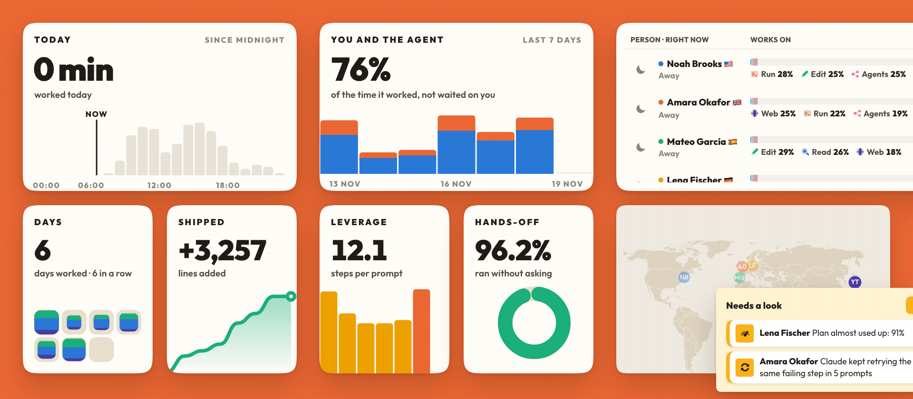

<p align="center">
  <picture>
    <source media="(prefers-color-scheme: dark) and (prefers-reduced-motion: reduce)" srcset="assets/readme/logo-dark.png">
    <source media="(prefers-color-scheme: dark)" srcset="assets/readme/logo-dark.gif">
    <source media="(prefers-reduced-motion: reduce)" srcset="assets/readme/logo-light.png">
    
  </picture>
</p>

<h1 align="center">Puddle</h1>

<p align="center"><em>Work has changed. See it differently.</em></p>

<p align="center">
  <a href="../../releases/latest"></a>
</p>

<p align="center">
  Free and open source · or get it at <a href="https://puddle.rip">puddle.rip</a>
</p>

<p align="center">
  <a href="LICENSE"></a>
  
  
</p>

<p align="center">
  <picture>
    <source media="(prefers-reduced-motion: reduce)" srcset="assets/readme/scene.png">
    
  </picture>
</p>

<p align="center"><sub>Puddle's demo: made-up people and projects.</sub></p>

---

You work with coding agents every day. Puddle shows how much, and what kind of work: hours with your agents, what
they spent them on, how often it went smoothly, your rhythm, your plan limits. It lives in the menu bar and needs
nothing from you after the first click.

Keep it to yourself, share a live page to show off, or point a future employer at it: yes, you really do have the
experience.

**It never reads your conversations.** No prompts, no answers, no code, no commands, no file contents. Counts and
timings, plus the names that tell your work apart (each project's folder and repo name, each conversation's title as
Claude Code shows it), and they stay on your Mac unless you sign in to share them. Every byte that can leave is listed in
[DATA.md](DATA.md), next to the code that sends it.

## Install

1. Download Puddle for Mac from [puddle.rip](https://puddle.rip) or the [latest release](../../releases/latest),
   double-click the zip and move **Puddle** to Applications.
2. Open it. It finds Claude Code and Codex by itself and reads the session logs they already keep, so your past work
   is there the first time you look.
3. Sign in only if you want to share with a team or a live page. New agent sessions then report live.

Needs a Mac with Apple silicon (M1 or newer) on macOS 12 or later, and
[Claude Code](https://claude.com/claude-code) or [Codex](https://github.com/openai/codex).

Only download Puddle from this repository's releases or puddle.rip.

**What signing in changes:** to share, Puddle switches on Claude Code's and Codex's own usage reports in their settings
files (backed up first). Signing out puts them back. Exactly what is written where:
[DATA.md](DATA.md#what-signing-in-changes-on-your-mac).

## What you see

- **Today:** time with agents, hour by hour, against a usual day.
- **You and the agent:** each day split into the time agents worked and the time they waited on you.
- **What you built:** web, iOS app or code, with the checks, builds and edits behind each, and the languages edited.
- **Shipped:** lines of code added, with commits, pushes and deploys.
- **Days, Leverage, Your week, Hands-off:** which days you worked, how many agent steps each prompt bought, when you
  usually work, and how much ran without asking you. All for the last 7, 30 or 90 days (7 when you
  open it). You place each card where you want it and pull its corner to
  resize it.
- **Plan limits:** how close you are to your Claude and Codex limits, and when they reset.
- **Your team:** who is working now, on which project, what needs a look, and everyone's limits.

## Questions

**How long until I see something?**
Seconds. Puddle finds Claude Code and Codex on its own and reads the history they already keep.

**Can I show it off?**
Yes. Share a live page of your records from the last 30 days, with the parts you pick. Anyone with the link sees it
update as you work.

**How does it work for a team?**
Create a team and invite people with a link. Everyone sees who is working now, on which project, what the agents are
doing and who is close to a limit, while each person keeps their prompts and code to themselves.

**Claude Code and Codex together?**
Yes. Both land in the same view, so a day that mixes them reads as one day of work. Adding another agent is a few
files: [docs/agents.md](docs/agents.md).

**What does it cost?**
Nothing. Puddle is free and open source, and teams are free during the beta.

**Does it work offline?**
Yes. Everything about your own work runs without an account. Signing in is only for live pages and teams.

**Intel Mac, Windows, Linux?**
Not yet. Puddle needs a Mac with Apple silicon (M1 or newer).

## Uninstall

1. Menu bar → right-click Puddle → **Remove Puddle…**. It puts Claude Code's and Codex's settings back, signs this
   Mac out, stops Puddle opening at login and quits.
2. Drag Puddle from Applications to the Bin.
3. Your history on this Mac is in `~/.puddle`: delete that folder to remove it too.

From a terminal, `puddle off` does step 1's settings part.

## Build it yourself

You need Node 22.13 or newer and Rust (`rustup`, with `cargo` on your PATH).

```bash
npm ci
npm test
npm run dev:app
```

`npm run dev:app` builds **Puddle Dev** ("DEV" in the menu bar) and installs it next to Puddle. A copy built from
source has no website to sign in to: everything else works, and nothing leaves your Mac.

| Folder | What it is |
|---|---|
| `companion-app/` | The menu bar app (Rust, Tauri): tray, windows, and the watchdog that keeps the helper running. |
| `companion/` | The helper (Node, bundled in the app): finds the agents and keeps them connected, Me, onboarding, updates. |
| `collector/` | The engine and the pages: reading telemetry and session logs, storage, the numbers, the charts. |
| `plugin/` | The `puddle` command and plugin for Claude Code and Codex. |
| `test/` | `npm test` |

## Contributing

Bug reports and new agents are very welcome: [CONTRIBUTING.md](CONTRIBUTING.md). Security issues go through
[SECURITY.md](SECURITY.md), not the issue tracker.

## License

[MIT](LICENSE).
