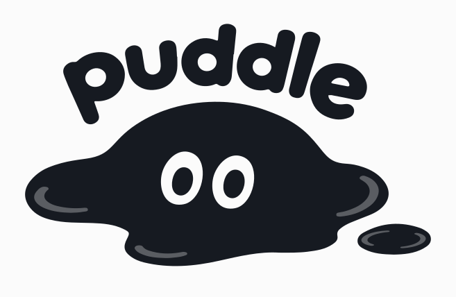

<p align="center">
  <picture>
    <source media="(prefers-color-scheme: dark)" srcset="assets/logo/logo-dark.svg">
    
  </picture>
</p>

<h1 align="center">Puddle</h1>

<p align="center"><em>Proof you ship with agents.</em></p>

<p align="center">
  <a href="LICENSE"></a>
  
  
</p>

---

You work with coding agents every day. Puddle shows how much, and what kind of work: hours with your agents, what
they spent them on, how often it went smoothly, your rhythm, your plan limits. It lives in the menu bar and needs
nothing from you after the first click.

Keep it to yourself, share a live page to show off, or point a future employer at it: yes, you really do have the
experience.

**It never reads what you wrote.** No prompts, no answers, no code, no commands, no file paths. Counts and timings
only, and they stay on your Mac unless you sign in to share them. Every byte that can leave is listed in
[DATA.md](DATA.md), next to the code that sends it.

## Install

1. Download Puddle for Mac from the [latest release](../../releases/latest) and move it to Applications.
2. Open it. It finds Claude Code and Codex on your Mac and reads the session logs they already keep.

That's it: nothing to configure, and your past work shows up right away.

Needs macOS on Apple silicon and at least one of [Claude Code](https://claude.com/claude-code) or
[Codex](https://github.com/openai/codex).

Only download Puddle from this repository's releases or puddle.rip.

## What you see

- **Today and this week:** time with agents, against a usual day.
- **What the agent worked on:** running commands, editing, reading, planning, connected tools.
- **How it went:** prompts that ran smoothly, ones you had to take over, conversations that ran out of room.
- **Your rhythm:** the last three months day by day, the hours you work, how much of it falls outside working hours.
- **Plan limits:** how close you are to your Claude and Codex limits, and when they reset, wherever the agents
  record them.

## FAQ

**Is my code uploaded?**
No, never, signed in or not. See [DATA.md](DATA.md).

**Does it work offline?**
Yes. Signing in is only needed to share a live page or join a team.

**Which agents?**
Claude Code and Codex today. Adding another is a few files: [docs/agents.md](docs/agents.md).

**Does it slow my agent down?**
No. It reads the logs the agents write anyway.

**Windows or Linux?**
Not yet.

## Build it yourself

You need Node 22.13 or newer and Rust (`rustup`).

```bash
npm ci
npm test
npm run dev:app
```

`npm run dev:app` builds **Puddle Dev** ("DEV" in the menu bar) and installs it next to Puddle. A copy built from
source has no website to sign in to: everything else works, and nothing leaves your Mac.

| Folder | What it is |
|---|---|
| `companion-app/` | The menu bar app (Rust, Tauri): tray, windows, and the watchdog that keeps the helper running. |
| `companion/` | The helper (Node, bundled in the app): finds the agents and keeps them connected, Me, onboarding, updates. |
| `collector/` | The engine and the pages: reading telemetry and session logs, storage, the numbers, the charts. |
| `plugin/` | The `joule` command and plugin for Claude Code and Codex. |
| `test/` | `npm test` |

## Contributing

Bug reports and new agents are very welcome: [CONTRIBUTING.md](CONTRIBUTING.md). Security issues go through
[SECURITY.md](SECURITY.md), not the issue tracker.

## License

[MIT](LICENSE).
