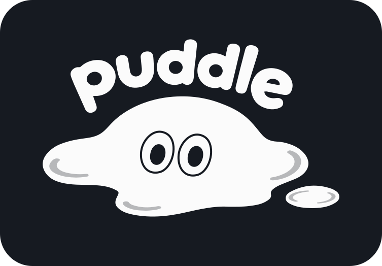
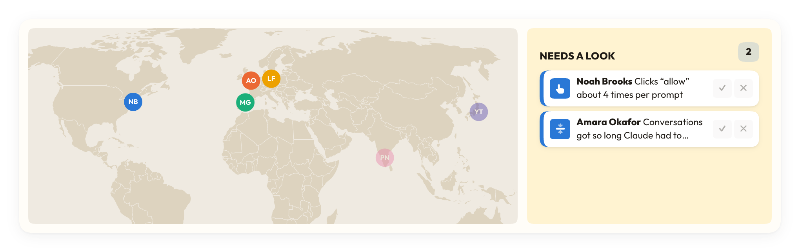
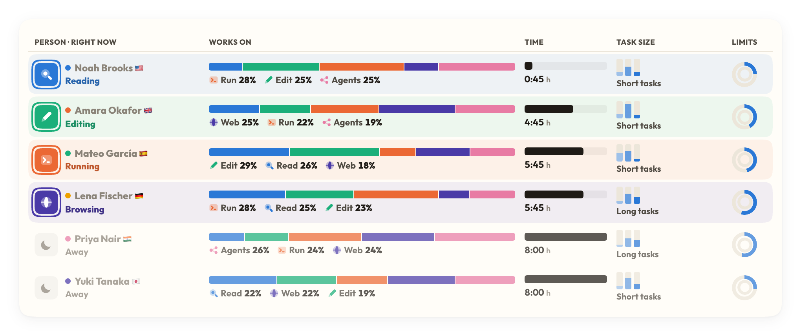
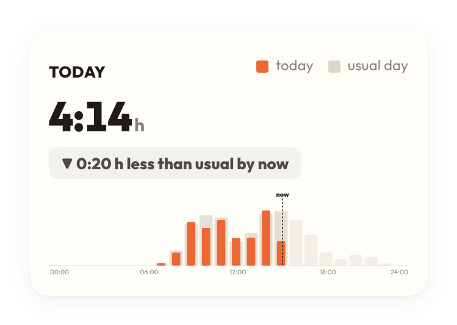
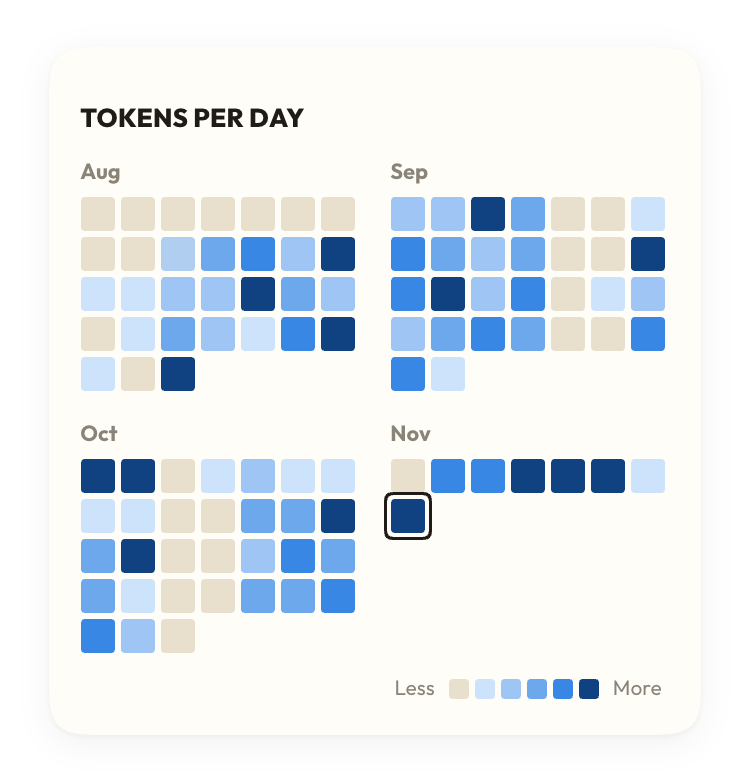
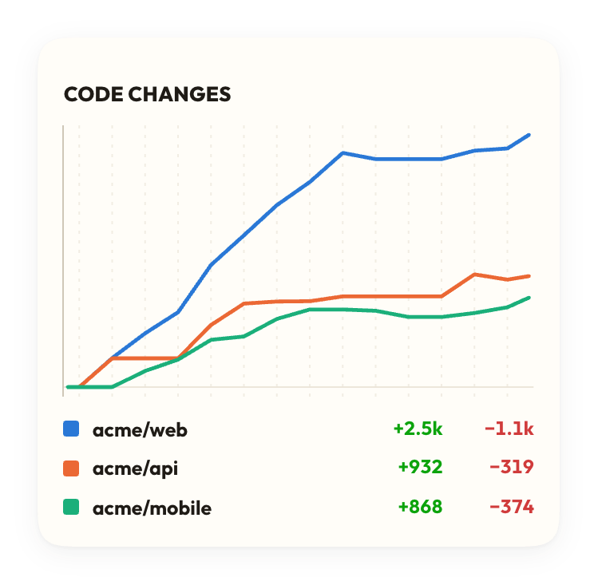

<p align="center">
  <picture>
    <source media="(prefers-color-scheme: dark)" srcset="collector/public/brand/logo-dark.svg">
    
  </picture>
</p>

<h1 align="center">Work has changed.<br>See it differently.</h1>

<p align="center">
  You don't just write code anymore. You run agents that write it.
  <b>Puddle</b> shows what that work really looks like: the hours, what your agents did, how often it went smoothly,
  and how close you are to your limits. Live, in your menu bar.
</p>

<p align="center">
  <a href="../../releases/latest"></a>
</p>

<p align="center">
  Free and open source · never reads your prompts or code · or get it at <a href="https://puddle.rip">puddle.rip</a>
</p>

<p align="center">
  <sub>Works with <b>Claude Code</b> and <b>Codex</b> · MIT · every field that can leave your Mac is in <a href="DATA.md">DATA.md</a> · your past work is in from the first open</sub>
</p>

<br>

## Your team, as it works

Who is working right now, from where, on what, and who is about to hit a limit. Puddle flags what needs a look before
it slows anyone down.

<p align="center">
  
</p>

<p align="center">
  
</p>

Everyone keeps their prompts and code to themselves. The team sees the work, never the words.

## You, day by day

Today against a usual day, three months of agent work at a glance, and the code it moved, project by project.

<p align="center">
  
  
  
</p>

Keep it to yourself, or share a live page with the cards you pick. It sits nicely next to a CV or a portfolio: yes,
you really do have the experience.

<sub>The pictures show Puddle's demo: made-up people and projects.</sub>

## What it sees, and what it never does

**It never reads your conversations.** No prompts, no answers, no code, no commands, no file contents. Counts and
timings, plus the names that tell your work apart (each project's folder and repo name, each conversation's title as
Claude Code shows it), and they stay on your Mac unless you sign in to share them. Every byte that can leave is listed
in [DATA.md](DATA.md), next to the code that sends it.

## Install

1. Download Puddle for Mac from [puddle.rip](https://puddle.rip) or the [latest release](../../releases/latest),
   double-click the zip and move **Puddle** to Applications.
2. Open it. It finds Claude Code and Codex by itself and reads the session logs they already keep, so your past work
   is there the first time you look.
3. Sign in only if you want to share with a team or a live page. New agent sessions then report live.

Needs a Mac with Apple silicon (M1 or newer) on macOS 12 or later, and
[Claude Code](https://claude.com/claude-code) or [Codex](https://github.com/openai/codex).

Only download Puddle from this repository's releases or puddle.rip.

**What signing in changes:** to share, Puddle switches on Claude Code's and Codex's own usage reports in their settings
files (backed up first). Signing out puts them back. Exactly what is written where:
[DATA.md](DATA.md#what-signing-in-changes-on-your-mac).

## What you see

- **Today and this week:** time with agents, against a usual day.
- **What the agents worked on:** running commands, editing and reading code, web research, sub-agents,
  connected tools, planning.
- **How it went:** prompts that ran smoothly, ones you had to take over, conversations that ran out of room.
- **Your rhythm:** the last three months day by day, the hours you work, how much falls outside working hours.
- **Plan limits:** how close you are to your Claude and Codex limits, and when they reset.
- **Your team:** who is working now, on which project, what needs a look, and everyone's limits.

## Questions

**How long until I see something?**
Seconds. Puddle finds Claude Code and Codex on its own and reads the history they already keep.

**Can I show it off?**
Yes. Share a live page with the cards you pick, and anyone with the link sees your work as it happens.

**How does it work for a team?**
Create a team and invite people with a link. Everyone sees who is working now, on which project, what the agents are
doing and who is close to a limit, while each person keeps their prompts and code to themselves.

**Claude Code and Codex together?**
Yes. Both land in the same view, so a day that mixes them reads as one day of work. Adding another agent is a few
files: [docs/agents.md](docs/agents.md).

**What does it cost?**
Nothing. Puddle is free and open source, and teams are free during the beta.

**Does it work offline?**
Yes. Everything about your own work runs without an account. Signing in is only for live pages and teams.

**Intel Mac, Windows, Linux?**
Not yet. Puddle needs a Mac with Apple silicon (M1 or newer).

## Uninstall

1. Menu bar → right-click Puddle → **Remove Puddle…**. It puts Claude Code's and Codex's settings back, signs this
   Mac out, stops Puddle opening at login and quits.
2. Drag Puddle from Applications to the Bin.
3. Your history on this Mac is in `~/.puddle`: delete that folder to remove it too.

From a terminal, `puddle off` does step 1's settings part.

## Build it yourself

You need Node 22.13 or newer and Rust (`rustup`, with `cargo` on your PATH).

```bash
npm ci
npm test
npm run dev:app
```

`npm run dev:app` builds **Puddle Dev** ("DEV" in the menu bar) and installs it next to Puddle. A copy built from
source has no website to sign in to: everything else works, and nothing leaves your Mac.

| Folder | What it is |
|---|---|
| `companion-app/` | The menu bar app (Rust, Tauri): tray, windows, and the watchdog that keeps the helper running. |
| `companion/` | The helper (Node, bundled in the app): finds the agents and keeps them connected, Me, onboarding, updates. |
| `collector/` | The engine and the pages: reading telemetry and session logs, storage, the numbers, the charts. |
| `plugin/` | The `puddle` command and plugin for Claude Code and Codex. |
| `test/` | `npm test` |

## Contributing

Bug reports and new agents are very welcome: [CONTRIBUTING.md](CONTRIBUTING.md). Security issues go through
[SECURITY.md](SECURITY.md), not the issue tracker.

## License

[MIT](LICENSE).
